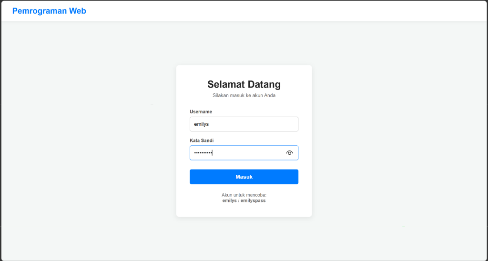
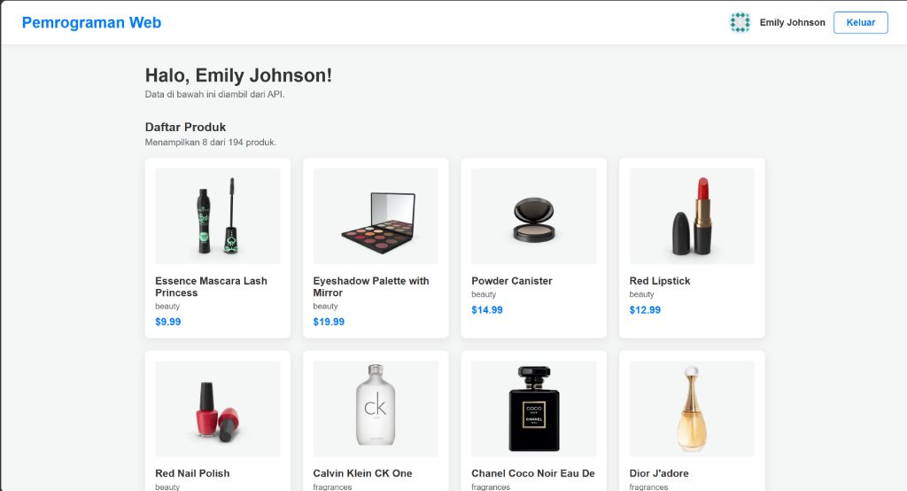

# Tugas Pemrograman Web — Login & Dashboard Produk

Aplikasi web sederhana yang menerapkan **HTML**, **CSS**, **JavaScript**, dan **API** untuk membuat sistem login dan dashboard produk.

---

## 📋 Deskripsi

Proyek ini terdiri dari dua halaman utama:

1. **Halaman Login** — Pengguna memasukkan username dan password yang dikirim ke API untuk diverifikasi.
2. **Halaman Dashboard** — Setelah login berhasil, menampilkan daftar produk yang diambil dari API secara real-time.

---

## 🛠️ Teknologi yang Digunakan

| Teknologi | Fungsi |
|-----------|--------|
| **HTML** | Struktur halaman (login form & kartu produk) |
| **CSS** | Tampilan & layout responsif menggunakan Flexbox dan Grid |
| **JavaScript** | Logika login, fetch API, manipulasi DOM |
| **API (DummyJSON)** | Autentikasi user dan pengambilan data produk |

---

## 🌐 API yang Digunakan

- **Login:** `POST https://dummyjson.com/auth/login`
- **Data Produk:** `GET https://dummyjson.com/products?limit=8`

---

## 📁 Struktur File

```
trakhir/
├── index.html       # Halaman login
├── dashboard.html   # Halaman dashboard produk
├── style.css        # Styling untuk semua halaman
├── login.js         # Logika login & komunikasi API
├── dashboard.js     # Logika dashboard & fetch data produk
└── docs/
    ├── screenshot-login.png      # Screenshot halaman login
    └── screenshot-dashboard.png  # Screenshot halaman dashboard
```

---

## 📸 Tampilan Aplikasi

### Halaman Login



### Halaman Dashboard



---

## 🚀 Cara Menjalankan

1. Clone atau download repository ini
2. Buka file `index.html` di browser (tidak perlu server lokal)
3. Login menggunakan akun percobaan:
   - **Username:** `emilys`
   - **Password:** `emilyspass`
4. Setelah login, akan otomatis diarahkan ke halaman dashboard

---

## ⚙️ Cara Kerja Aplikasi

### Alur Login
1. User mengisi form username & password
2. `login.js` mengirim request `POST` ke API DummyJSON
3. Jika berhasil → token & data user disimpan di `localStorage`, lalu redirect ke `dashboard.html`
4. Jika gagal → menampilkan pesan error

### Alur Dashboard
1. `dashboard.js` mengecek apakah token ada di `localStorage`
2. Jika tidak ada → redirect kembali ke `index.html`
3. Jika ada → menampilkan nama & foto user, lalu fetch data produk dari API
4. Data produk ditampilkan sebagai kartu (grid layout)

### Logout
- Klik tombol **Keluar** → token & data user dihapus dari `localStorage` → redirect ke `index.html`

---

## 👤 Pembuat

**Nama:** Azzah Rafidah Nurdini  
**Kelas:** Pemrograman Web - H
**Semester:** 5
